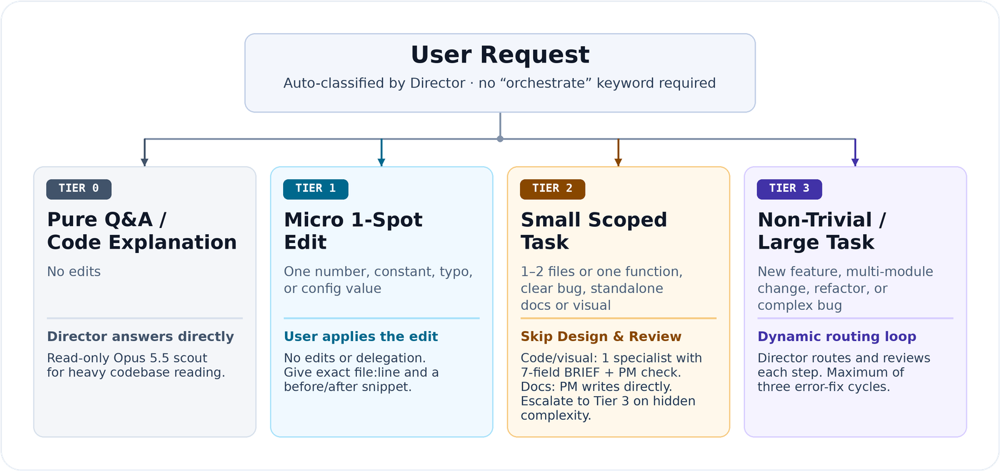
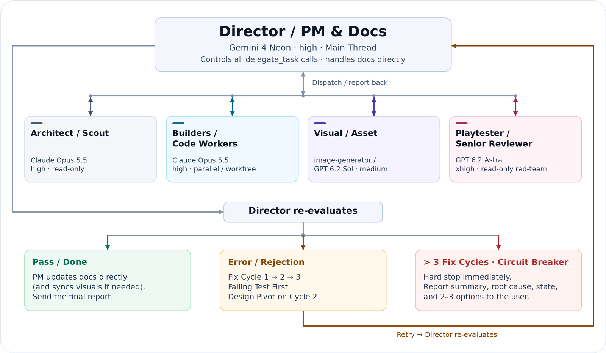

# Oh-My-Orchestration

A compact, production-tested **dynamic multi-model orchestration skill** for **T3 Code** and **Antigravity**.

Instead of a rigid `Plan -> Build -> Review` waterfall, a lightweight central **Director/PM** classifies every incoming request across 4 tiers, dynamically routes engineering & visual work to specialized frontier models across providers, handles user-facing documentation directly with the `im-not-ai` (`humanize-korean`) skill, enforces command-verified handoffs and cross-family adversarial reviews, and halts cleanly at a hard **3-cycle circuit breaker**.

---

## Architecture

### 4-Tier Auto-Routing



### Hub-and-Spoke Dynamic Routing (Option A)



---

## Model Roster

| Role | Provider | Model | Options | Scope |
| :--- | :--- | :--- | :--- | :--- |
| **Director / PM & Docs** | Main thread (`antigravity`) | `Gemini 4 Neon` | `{"thought_level": "high"}` | Routing, 7-field briefs, verification, fix-cycle cap, reporting, and direct docs/copywriting (`docs/`, `README.md`, `CHANGELOG.md`, UI/i18n) polished with `im-not-ai` (`humanize-korean`) |
| **Architect / Scout** | `claudeAgent` | `claude-opus-5-5` | `{"effort": "high"}` | Read-only scouting, architecture blueprints, mid-flight design pivots |
| **Code Worker / Builder** | `claudeAgent` | `claude-opus-5-5` | `{"effort": "high"}` | Tier 2 edits, Tier 3 parallel/worktree slices, failing-test-first fixes |
| **Visual / Asset Designer** | Native / `codex` | `image-generator` / `gpt-6.2-sol` | `--` / `{"reasoningEffort": "medium"}` | Raster art/icons/banners (`image-generator`); charts/SVG/GIF scripts (`gpt-6.2-sol`) |
| **Playtester / Senior Reviewer** | `codex` | `gpt-6.2-astra` | `{"reasoningEffort": "xhigh"}` | Read-only adversarial cross-provider playtesting & test-quality audit |

> **Why cross-family review?** Same-family reviewers share the builder's blind spots. Keeping design & implementation on **Claude (`Opus 5.5`)** while delegating adversarial red-team review to **Codex (`GPT 6.2 Astra xhigh`)** — supervised neutrally by **Gemini (`Gemini 4 Neon`)** — prevents rubber-stamping and catches silent regressions before they land.

---

## Key Engineering Disciplines

- **Mandatory 7-Field Handoff `BRIEF`**: Every child delegate starts with zero parent history. All briefs specify `BRIEF FOR`, `ROLE`, `GOAL`, `CONTEXT`, `DONE WHEN` (an executable exit-0 command or objective checklist — never an opinion), `DO NOT`, and `RETURN`. See [`templates/BRIEF.md`](./templates/BRIEF.md).
- **Direct PM Docs (CommonMark + [`im-not-ai`](https://github.com/epoko77-ai/im-not-ai))**: Instead of spawning a separate copywriter model, the Director/PM (`Gemini 4 Neon`) writes user-facing documentation (`docs/`, `README.md`, `CHANGELOG.md`, UI/i18n) directly following **CommonMark** rules by default, and runs Korean deliverables through the required [`im-not-ai`](https://github.com/epoko77-ai/im-not-ai) (`humanize-korean` / `humanize-scan`) skill to eliminate AI-isms and translationese.
- **Failing Test First**: When fixing testable bugs or `[Critical]`/`[Major]` review findings, builders write a failing regression test reproducing the issue *before* writing the fix.
- **Adversarial Playtester Checklist**: `GPT 6.2 Astra` audits both **code and test quality** against empty/null inputs, huge boundaries, concurrency/race conditions, slow/failing I/O, Unicode/non-ASCII strings, auth/permission edge cases, and blueprint drift.
- **Hard Circuit Breakers**:
  - **Max 3 Error-Fix Cycles** (`1/3 Targeted Fix` -> `2/3 Root-Cause Pivot` -> `3/3 Final Controlled Attempt` -> **Hard Stop & Human Escalation**).
  - **Sensitive-File Lock**: `.env*`, DB `migrations`, and CI/deploy configs cannot be edited without explicit human approval.
  - **Autonomous Handoff Cap**: Max 4 unattended agent-to-agent handoffs without checking in with the user.
- **Worktree & Resource Hygiene**: At most 1 writer on the main checkout for overlapping paths; use `isolation: "worktree"` for large independent parallel features and keep concurrent builders lean (<= 2–3) to avoid MCP/RAM bloat.
- **Language Separation**: All internal briefs, blueprints, reports, and reviews stay strictly in concise English for token efficiency and technical precision; user-facing replies and Korean docs default to natural, humanized Korean (easily customizable in `SKILL.md`).

---

## Prerequisites

### Required Companion Skill: `im-not-ai` (`humanize-korean`)

This preset relies on **[epoko77-ai/im-not-ai](https://github.com/epoko77-ai/im-not-ai)** so the Director/PM (`Gemini 4 Neon`) can polish Korean documentation (`docs/`, `README.md`, `CHANGELOG.md`, UI copy) and eliminate AI-isms and translationese. **Install `im-not-ai` before using Korean docs workflows:**

#### 1. Clone & Install for Antigravity / T3 Code (Recommended)

```bash
git clone https://github.com/epoko77-ai/im-not-ai.git ~/.local/share/im-not-ai
cd ~/.local/share/im-not-ai
./install.sh   # Auto-detects Claude Code, Codex CLI, and Gemini CLI

# Link skills into Antigravity's global skills directory
mkdir -p ~/.gemini/config/skills
for s in humanize humanize-korean humanize-redo humanize-scan; do
  ln -sfn ~/.local/share/im-not-ai/skills/"$s" ~/.gemini/config/skills/"$s"
done
```

#### 2. Alternative Install Methods

- **Gemini CLI Extension (no clone)**:
  ```bash
  gemini extensions install https://github.com/epoko77-ai/im-not-ai.git
  ```
- **Claude Code Plugin Marketplace (no clone)**:
  ```text
  /plugin marketplace add epoko77-ai/im-not-ai
  /plugin install humanize-korean@im-not-ai
  ```

For full details, updates, and uninstall options, see the upstream [`im-not-ai` repository](https://github.com/epoko77-ai/im-not-ai).

---

## Installation

### Global Install (Antigravity / T3 Code)

```bash
git clone https://github.com/Leehyunbin0131/Oh-My-Orchestration.git
cd Oh-My-Orchestration
./install.sh
```

This installs `skills/my-orchestration/SKILL.md` into:

```text
~/.gemini/config/skills/my-orchestration/SKILL.md
```

### Project-Local Install

Copy the skill folder directly into your repository's `.agents/skills/` directory:

```bash
mkdir -p .agents/skills
cp -r skills/my-orchestration .agents/skills/
```

---

## Repository Layout

```text
Oh-My-Orchestration/
├── README.md
├── LICENSE
├── install.sh                          # Installs SKILL.md into ~/.gemini/config/skills/
├── assets/
│   ├── auto-routing.png
│   └── dynamic-routing.png
├── skills/
│   └── my-orchestration/
│       └── SKILL.md                    # Compact 72-line auto-activating skill definition
└── templates/
    └── BRIEF.md                        # Reusable 7-field handoff brief templates by role
```

---

## Customization

- **Swap models/providers**: Edit Section 1 (`Roster`) in [`skills/my-orchestration/SKILL.md`](./skills/my-orchestration/SKILL.md) (for example, switching Architect to `claude-fable-5-2` when available).
- **Change user-facing language**: Edit Section 6 (`Operations, Language & Overrides`) in `SKILL.md` if you prefer English or another language for user replies and documentation.
- **Per-thread overrides**: Simply tell the Director in chat (e.g., *"use Tier 3 for this"* or *"use `xhigh` for the builder"*); per-thread overrides work without modifying `SKILL.md`.

## License

[MIT](./LICENSE)
